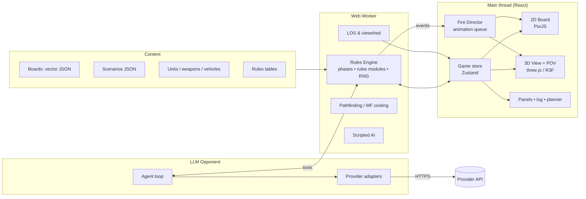

# Squad War: Project Plan

A computer version of WWII squad-level tactical hex combat. It uses the game mechanics in the 4th Edition *Squad Leader* rulebook (Avalon Hill, 1977) that the project owner supplied. You get a zoomable printed-style hex board, a rotatable 3D landscape, an LOS inspector, a move planner you can revert, animated fire, a first-person POV camera and an LLM opponent.

**Status:** M0–M5 are built; see [Progress](#progress). Owner decisions are in [§13](#13-decisions). Companion documents:

- [RULES_COVERAGE.md](RULES_COVERAGE.md): every rule section, mapped to an engine module and a milestone.
- [REFERENCE_TABLES.md](REFERENCE_TABLES.md): Quick Reference Data Card values, the engine's default rules data.

---

## Progress

| Milestone | State | Notes |
|---|---|---|
| M0 Foundations | Done | pnpm monorepo, CI, Pages workflow, ADRs. Plain CSS tokens instead of Tailwind (ADR 0001). |
| M1 Hex map and 2D board | Done | Hex math, geomorphic boards and the board editor. City A is reworked as an organically grown town. Board files store hex attributes and the symbol shapes are generated (ADR 0003). |
| M2 LOS | Done | Categorical LOS (ADR 0004), LOS Inspector with profile and viewshed, conformance and reciprocity tests. |
| M3 Infantry core | Done | §1–21 engine with rules traces, scenario 1, saves and replays, battle screen for hot-seat and vs. bot. The heuristic bot was pulled forward from M7 so that bot-vs-bot soak tests exist (nightly workflow). |
| M4 Planner and first playable | Done | Move Planner (alternatives, exposure badges, expected breaks, commit or revert), danger map, fire odds and suggested targets, Assisted automation. The planner allows only dice-free actions, so it can't reveal future rolls. Before the Movement Phase it runs as a rehearsal. |
| M5 3D view | Done | 3D landscape built from the board data (ADR 0005): painted ground, extruded buildings with hip roofs, instanced trees, walls and hedges, counter standees. 2D, 3D and split views share every overlay. 3D LOS ray between eye heights, draped viewshed, Eyes (leader POV) with rules-decided enemy visibility. Quality presets and a height slider. |
| Tutor mode | Done | Added on request after M5: AI vs AI play with pause, step and speed; the bot explains every decision (goal, reasons with odds and rule references, options weighed, a lesson); finished games go to a saved-game library; Review steps through any saved game decision by decision, with the outcome and map highlights, and lets you take over either side from any point (ADR 0006). |
| M6–M12 | Not started | |

Deviations from this plan so far:

- **Engine runs on the main thread.** Viewshed takes about 50 ms on one board; a worker can come later.
- **The bot exists early.** It was built in M3 instead of M7, for soak testing and the offline opponent.
- **Rulings** are tracked in [docs/rulings.md](rulings.md).
- **3D uses plain three.js**, not react-three-fiber (ADR 0005). There is no Ultra preset yet, and the "drone" free-fly camera and camera bookmarks are deferred.
- **POV incoming fire** is part of the Fire Director (M6). M5's Eyes view is static: it shows what the unit sees, with rules visibility.

## Contents

1. [Summary](#1-summary)
2. [Original content vs. rulebook](#2-original-content-vs-rulebook)
3. [Product overview](#3-product-overview)
4. [Architecture and tech stack](#4-architecture-and-tech-stack)
5. [Map and terrain model](#5-map-and-terrain-model)
6. [Rules engine](#6-rules-engine)
7. [Feature specs (the seven requested features)](#7-feature-specs)
8. [Scenarios, Design-Your-Own, Campaign](#8-scenarios-design-your-own-campaign)
9. [Visual and UX design](#9-visual-and-ux-design)
10. [Milestones](#10-milestones)
11. [Testing strategy](#11-testing-strategy)
12. [Risks and mitigations](#12-risks-and-mitigations)
13. [Decisions](#13-decisions)
14. [Appendix: data schema sketches](#14-appendix-data-schema-sketches)

---

## 1. Summary

- **Platform:** browser only, by the owner's decision. A TypeScript app that can be installed as a PWA. Everything runs client-side: rules engine, 3D, AI bot and saves. The only network traffic is to the LLM provider the player picks. Nothing in the feature set needs a server or a desktop build.
- **Rules:** a pure, deterministic rules engine. It covers the rulebook's sequence of play, §1–§63, the optional rules, Design-Your-Own and the Campaign Game. Rules unlock in the same building-block order the rulebook uses for its programmed instruction.
- **One terrain model:** each board is stored once, as vector data. That one source draws the 2D board art, drives the LOS geometry and builds the 3D landscape. What you see in 3D is exactly what the rules compute.
- **The seven requested features:**

| # | Request | Feature in this plan | Spec |
|---|---|---|---|
| 1 | Pick two points, see if LOS exists, draw the line and show the obstruction | **LOS Inspector**, plus elevation profile and viewshed | [§7.2](#72-feature-1-los-inspector) |
| 2 | Map out moves in advance, check movement points, then revert | **Move Planner**, a sandbox branch of the game state | [§7.3](#73-feature-2-move-planner-what-if-and-revert) |
| 3 | Top-down zoomable map plus a rotatable, zoomable 3D landscape | **2D Board** and **3D Terrain View**, synced | [§7.1](#71-top-down-board-2d), [§7.4](#74-feature-3-3d-landscape-view) |
| 4 | Show fire travelling from source to target during fire phases | **Fire Director** (tracers, shells, impacts) | [§7.5](#75-feature-4-fire-director-animated-fire) |
| 5 | POV of a leader or moving vehicle, including incoming fire | **POV Cam** (watch only, no gameplay) | [§7.6](#76-feature-5-pov-cam) |
| 6 | User enters an LLM API key, picks provider and model; the LLM is the opponent | **LLM Opponent** (tool-calling agent, fog of war) | [§7.7](#77-feature-6-llm-opponent) |
| 7 | Optional automation to streamline phases | **Automation Levels** and **Standing Orders** | [§7.8](#78-feature-7-automation) |

- **First playable** is milestone M4: infantry hot-seat play on an original city board, with the LOS Inspector and Move Planner. Later milestones add 3D, animated fire, the LLM opponent, armor, POV and the rest of the rules (see [§10](#10-milestones)).

---

## 2. Original content vs. rulebook

The project uses the rulebook's game mechanics. Everything you see on screen is original. This keeps the project a new game in the same genre, not a copy of the published product.

| Area | Approach |
|---|---|
| **Rules mechanics** (sequence of play, movement factors, LOS, fire, morale, rout, rally, close combat, AFVs, artillery, …) | Implemented from the supplied rulebook. Help text is paraphrased in our own words, with § cross-references so players can check their own copy. |
| **Numeric tables and unit data** (Infantry Fire Table, Close Combat Table, To Hit, AFV Kill, terrain DRMs, MF and MP costs, artillery tables, unit factors) | **Complete.** Transcribed in **[REFERENCE_TABLES.md](REFERENCE_TABLES.md)** from three sources: the owner's photos of both sides of the *Quick Reference Data Card*, the tables embedded as images in the rulebook PDF, and the rulebook's Point Value Chart counter art. These are the engine's default values. The engine is fully table-driven, and an in-app **Rules Data editor** lets the owner check or adjust any value. |
| **Boards** | **Original** geomorphic boards drawn in the classic printed-hex style: hex IDs, center dots, color-coded terrain, three shaded hill levels with crest lines, and walls and hedges on hexsides. They are *not* copies of the published boards. |
| **Scenarios** | **Original** set of 12 scenarios. They teach the rules in the same order as the rulebook's programmed instruction and are set in other historical WWII engagements. We also add the rulebook's Design-Your-Own random generator and a full scenario editor. The published scenario cards are not reproduced. |
| **Name and art** (title, counters, UI, audio) | Original. The published game's name is not used in the app. |
| **The rulebook PDF** | Not committed to this repository. |

---

## 3. Product overview

### 3.1 Game modes

- **vs. LLM**: the human plays one side and an LLM plays the other ([§7.7](#77-feature-6-llm-opponent)).
- **vs. Bot**: a built-in scripted AI. It works offline, needs no key, and is the fallback when an LLM fails.
- **Hot-seat**: two humans at one screen. A "hide my side" curtain covers hidden placement and concealment.
- **Spectate**: LLM vs. LLM, LLM vs. Bot, or Bot vs. Bot. Useful for fun, balance testing and soak tests.
- **Tutorial track**: scenarios 1–12 in programmed-instruction order. Each one shows a "new rules in this scenario" briefing.
- **Design-Your-Own**: random scenario generation (Game Set IV).
- **Campaign**: a persistent leader identity carried across scenarios (Game Set IV).
- **Online play against other people** is out of scope (owner's decision).

### 3.2 Play styles

| Mode | What it allows |
|---|---|
| **Study** (default) | Free LOS checks, Move Planner, fire odds previews and undo before dice are rolled. This is the mode the requested features need. |
| **By the Book** | Enforces the rulebook's procedures: no take-backs once a unit enters a hex or the player lets go of it (§19.1–19.2), and no "potential" LOS checks (§19.3). LOS is checked only after firers are declared, and declared units must fire even if LOS turns out blocked, so support weapons can still break down. The planner is off. |

### 3.3 Screens

1. **Home**: continue, new game, tutorial track, campaign, Design-Your-Own, editors, settings.
2. **Scenario briefing**: historical blurb, map preview in 2D and 3D, orders of battle, victory conditions, special rules, rules level, side choice, opponent choice, balance options (the rulebook's agreed-upon artillery trade-offs, §45).
3. **Battle**: the main screen ([§9.2](#92-battle-screen-layout)).
4. **After-action report**: casualties, a turn-by-turn replay scrubber, and the LLM's commentary. That commentary stays hidden until the game ends.
5. **Editors**: board editor, scenario editor, rules data editor.
6. **Settings**: AI provider, key and model; automation; graphics quality; audio; accessibility.

---

## 4. Architecture and tech stack

### 4.1 Principles

1. **Pure, deterministic engine.** `(state, action) → (state', events[])`. There is no DOM and no wall clock. All dice come from a seeded PRNG stored in the state.
2. **Event-sourced.** A game is `scenario + seed + action log`. That one design gives us saves, replays, undo, the Move Planner's forks, network play later, and a perfect record for animations.
3. **One terrain source of truth.** Vector board data feeds the 2D renderer, the LOS math and the 3D mesh.
4. **Renderers are views.** The 2D board, 3D view and POV cam all subscribe to the same store and engine event stream, so selections and overlays stay in sync.
5. **AI never touches state directly.** The bot and the LLM submit the same validated actions a human would.
6. **Every resolution explains itself.** Each fire, morale check, rout or move cost produces a *rules trace* with § references ([§6.6](#66-rules-traces-explain-every-result)).

### 4.2 Component diagram



### 4.3 Tech stack

| Concern | Choice | Why |
|---|---|---|
| Language and build | TypeScript (strict), pnpm workspaces, Vite | One language across engine, UI and AI. Fast builds. |
| UI | React, Tailwind, Radix UI primitives | Accessible components and quick styling. |
| State | Zustand for UI state; Immer for structural sharing in the engine | Cheap snapshots, which the Move Planner needs. |
| Engine hosting | Web Worker via Comlink | Keeps the UI at 60 fps during viewshed and AI work. |
| 2D board | PixiJS (WebGL) and pixi-viewport | Smooth pan, zoom and pinch with thousands of sprites. |
| 3D and POV | three.js with react-three-fiber, drei and postprocessing | Mature ecosystem: instancing, LOD, post effects. |
| Schemas | Zod, converted to JSON Schema | Validates content files *and* defines the LLM tool schemas from one source. |
| Persistence | IndexedDB via Dexie; JSON export and import | Saves, replays, profiles, campaign files. |
| Audio | Howler.js | Positional-ish SFX, ambience. |
| Tests | Vitest, fast-check (property tests), Playwright (end-to-end and visual) | See [§11](#11-testing-strategy). |
| Packaging | Static site (GitHub Pages) and PWA, works offline except LLM calls | Zero install; browser only. |

### 4.4 Repository layout (planned)

```
squadleader/
├─ apps/
│  └─ web/              # React app: battle screen, editors, settings
├─ packages/
│  ├─ hex/              # hex math, coordinates, board composition (geomorphic butting)
│  ├─ terrain/          # vector terrain model, board loader, derived hex attributes
│  ├─ los/              # LOS, blind hexes, hindrances, viewshed, elevation profiles
│  ├─ engine/           # rules engine: state, actions, events, phases, rules modules, RNG
│  ├─ tables/           # table-driven data access (IFT, CC, To Hit, Kill, TEC, charts)
│  ├─ content/          # boards, scenarios, unit/weapon/vehicle data, default tables (JSON)
│  ├─ render2d/         # Pixi board renderer, overlays, counters
│  ├─ render3d/         # terrain mesh, buildings, trees, units, effects, POV rigs
│  ├─ fx/               # Fire Director: event → animation timelines (shared by 2D/3D)
│  ├─ ai-bot/           # scripted utility AI (influence maps)
│  ├─ ai-llm/           # provider adapters, tools, prompts, fog-of-war serializer
│  └─ ui/               # design system components
└─ docs/                # this plan, rules coverage, ADRs, rulings
```

---

## 5. Map and terrain model

### 5.1 Geomorphic boards and coordinates

- **Board shape.** Long, narrow geomorphic boards with flat-top hexes in lettered columns and numbered rows. Each hex is 40 m across.
- **Half-hexes.** Edge half-hexes merge when boards are butted together (rulebook §3.4–3.7). Board-edge half-hexes are playable.
- **Display IDs.** The format is *board + column + row*, for example `B3-K5`. When two edge half-hexes merge, the hex takes its ID using the rule in §3.5.
- **Internal coordinates.** The engine uses axial/cube coordinates on the *composed* map. A board's placement record (offset and 180° rotation) maps local hexes to global ones.
- **Scenario layouts.** Scenarios specify board layouts, for example two boards side by side or three boards in an L. The editor previews the composition.

### 5.2 Vector terrain layers (one file per board)

| Layer | Geometry | Used for |
|---|---|---|
| `elevation` | Polygons for Level 1, 2 and 3. Their edges are the **crest lines**. | Hill levels (§43). A hex's level is the level under its **center dot** (§43.14). The 3D heightfield is built from these. |
| `woods` | Polygons (the woods *symbol*, not the whole hex) | LOS blocking by symbol (§7.2), TEM, movement |
| `buildings` | Footprint polygons with `{id, material: wood\|stone, stories, stairways[]}` | Multi-hex building identity: 3+ hexes means multi-story with a 2-hex blind zone (§7.4, §43.62). Also upper levels (§57). |
| `hexsides` | Per-hexside flags: `wall`, `hedge`, `cliff`, plus road connectivity | Hexside TEM and movement (§5.51, §11.5, §44.1) |
| `roads` | Polylines, paved or dirt (cosmetic only, §3.6) | Road rate when entered through a road hexside (§5.52) |
| `fields` | Wheatfield polygons (seasonal), shellhole stamps, marsh, water and river | §44.2–44.3, §60 |
| `features` | Sewer entrances, bridges, fords | §27, §60 |
| `decor` | Paths, sidewalks, fences | Cosmetic only (§3.6) |

**Derived hex attributes** are computed by sampling the vectors and can be overridden in the editor: base terrain, level, terrain *symbols present*, building ID, MF cost inputs, TEM inputs and sewer access. **Dynamic terrain** consists of counters on the map: smoke, fire, rubble, wrecks, wire, entrenchments, minefields (hidden), bunkers and roadblocks.

### 5.3 Board editor and generator

- **Editor tools:** paint and vector tools for each layer, snapped to the hex grid; hexside toggles; a building tool that groups footprints into multi-hex buildings; and a live LOS test. The editor runs a validation pass that flags crest lines crossing center dots and buildings with no hex center.
- **Procedural assist:** a seedable generator for village, town-block, farmland, hills and woods layouts. Its output is a *starting point* the designer then hand-tunes.
- **Initial boards:** two city boards and three countryside boards (open farmland, hills, woods and villages). That is enough for the 12 scenarios and Design-Your-Own. More boards can be added later.

---

## 6. Rules engine

### 6.1 State, actions and events

- **`GameState`** holds: scenario reference, composed map reference, turn, phase and step, active side, units, support weapons, vehicles, markers, track hexes, melee hexes, artillery state, the RNG state and the visibility model (what each side knows).
- **Actions** are the commands. Examples: `RallyAttempt`, `RepairSW`, `DeclareFireGroup`, `MoveStep`, `EndUnitMove`, `DefensiveFire`, `RoutMove`, `AdvanceMove`, `AllocateCloseCombat`, `PlaceArtilleryRequest`, `ConcealUnit`, `EndPhase`.
- **Events** are the facts. Examples: `DiceRolled`, `FireResolved{column, drm, result}`, `MoraleCheck{unit, need, roll, passed}`, `UnitBroke`, `UnitEliminated`, `SWBrokeDown`, `MovedInto{hex, mfSpent}`, `BerserkTriggered`, `LOSChecked`.
- **Validation.** Every action is validated against the current phase and rules. Illegal actions are rejected with a reason and a § reference. The UI, the bot and the LLM all use the same rejection path.

### 6.2 Sequence of play as a state machine

Each game turn has two player turns of eight phases (§4). Steps inside each phase follow the rulebook's **Advanced Sequence of Play** (p. 41). For example, the Rally Phase runs in this order:

1. Clear roadblock, wreck and TI markers.
2. Repair weapons and AFVs.
3. Rally broken units.
4. Radio contact.
5. Artillery request.
6. Correct spotting rounds and FFE.
7. Roll night visibility.
8. Place starshells.
9. Clear DM markers.

```
GameTurn ─┬─ PlayerTurn(attacker) ─ Rally → PrepFire → Movement → DefensiveFire
          │                           → AdvancingFire → Rout → Advance → CloseCombat
          └─ PlayerTurn(defender) ─ (same 8 phases) ─→ advance Turn Record Track
```

Phases that only one side acts in, such as Movement, hand control to that side. Phases where both sides act (Rally, Rout, Close Combat) run in the order the rules give: the moving player routs first (§4.6, §13.2), leaders take morale checks first (§8.8), and so on.

### 6.3 Rules modules

Each rule section maps to a module of pure functions. Every function is documented with its § number and has unit tests that cite the same §. The full mapping is in [RULES_COVERAGE.md](RULES_COVERAGE.md). Main modules:

| Module | Rules covered |
|---|---|
| `movement` | MF costs, hexside costs, road rate, uphill doubling, portage, leader bonus |
| `stacking` | Stacking limits |
| `los` | LOS, blind hexes, hindrances |
| `fire` | Fire groups, firepower modifiers, IFT, TEM, MG penetration, defensive-fire track hexes |
| `morale` | Morale checks, leader-loss checks |
| `rout` | Legal rout-path search |
| `rally` | Rally and Desperation Morale |
| `leadership` | Leader modifiers for fire, morale and rally |
| `fate` | Breakdown, repair, rolls of 12, berserk |
| `closeCombat` | Odds, kill number, melee |
| `infantrySpecial` | Flamethrowers, demolition charges, smoke, concealment, fanaticism, sewers |
| `afv` | Facing and covered arc, vehicle movement, To Hit, Kill, overruns, immobilization, wrecks, transport, halftracks, AT guns |
| `artillery` | Modules, radio contact, request, spotting round, correction, FFE, blast area; on-board artillery |
| `environment` | Night, snow, seasonal wheatfields, fire spread, rubble |
| `fortifications` | Wire, entrenchments, minefields, bunkers, roadblocks, upper levels |
| `nationality` | Russian fanaticism and berserk; American traits (§50) |
| `victory` | A small victory-condition language ([§14](#14-appendix-data-schema-sketches)) |

### 6.4 Table-driven numbers

`packages/tables` holds the Infantry Fire Table, Close Combat Table, To Hit and AFV Kill tables, terrain DRMs and MF costs, the support-weapon chart, artillery module tables, and the Design-Your-Own charts. All are versioned JSON validated by Zod.

- **Default values:** transcribed in [REFERENCE_TABLES.md](REFERENCE_TABLES.md) from both sides of the owner's Quick Reference Data Card, the rulebook's embedded tables and its counter roster.
  - The data is complete.
  - A few items marked ⚠️ are interpretation checks, scheduled at the milestone that uses them.
- **Variant table sets:** the *Crescendo of Doom* card has a different Close Combat Table and different IFT HE pairings. It can be added as a variant set for future expansion rules, selected per scenario.
- The **Rules Data editor** shows each table as an editable grid. Next to it is a probability heat-map of the outcome distribution (2d6 combined with DRMs), so you can see what a change does to the odds.
- Saves record the table-set hash, so replays reproduce exactly.

### 6.5 Rulings registry

`docs/rulings.md` plus `engine/rulings.ts` are named switches for every interpretation call. Examples:

- How to treat an LOS that grazes a symbol.
- Whether rout may pass through a smoke hex.
- Which leader modifier applies when two leaders are present.

The rulebook's Q&A appendix is applied by default. Each ruling is documented with its source.

### 6.6 Rules traces: explain every result

Every resolution emits a human-readable trace shown in the combat log. For example:

> **Fire** B3-K5 → B3-N6. Fire group: 2× squad (4 FP each) and MMG (4 FP).
> Squads are beyond printed range, so their FP is halved (§9.2): 8 → 4. MMG 4. Total 8 FP, column **8** (§10.3).
> DRM: leader −2 (§15.2), target in woods +1 (§11.1). Net **−1**.
> Dice 4+4 = 8; modified 7. Result **+1 MC**.
> Morale checks, leader first (§8.8). Lt. Volkov (morale 8, leadership 0) needs 7 or less, rolls 5: passes. Squad A (morale 7) needs 6 or less, rolls 9: **breaks**.

### 6.7 Dice

- **Digital only** (owner's decision): a seeded PRNG with an optional animated 3D dice tray. The roll is decided first; the dice animation then lands on the decided faces.
- A dice-statistics panel shows distributions so far. It's mostly there to settle "these dice hate me" debates.

---

## 7. Feature specs

### 7.1 Top-down board (2D)

- **Rendering:** PixiJS draws the vector board into cached textures at several zoom tiers. Hex grid, hex IDs and center dots fade in or out by zoom level.
- **Pan and zoom:** mouse wheel, trackpad pinch and keyboard. Double-click centers on a hex. Zoom runs from whole-map view down to a single hex.
- **Semantic zoom:**
  - Far out: stacks show as compact badges with nationality color, unit count and broken or concealed state.
  - Mid-range: full counters.
  - Close in: counters fanned out, with markers and hexside detail.
- **Hover card per hex:** terrain, level, MF cost to enter from the hovered direction, TEM, occupants, markers.
- **Overlays (toggleable):**
  - LOS line and profile.
  - Movement path with per-hex MF labels.
  - Threat heat-map: enemy FP in LOS, by expected effect.
  - Viewshed.
  - Defensive-fire exposure.
  - Track hexes.
  - Fire-lane lines for MG penetration.
  - Setup zones.
  - Victory objectives.
- **Minimap and Turn Record Track** are docked in the UI chrome.

### 7.2 Feature 1: LOS Inspector

**Interaction.** Pick the LOS tool (key `L`), then click hex A and hex B, or drag from A to B. Holding `Shift` keeps A pinned while you hover over other hexes as B, giving live LOS. You can also right-click a unit and choose **LOS from here**.

**What it shows:**

- **The line** runs from center dot to center dot. It is green while clear. At the first blocking point it turns red and continues dashed past it.
- **The obstruction** is highlighted: the woods or building symbol polygon, crest line, wall or hedge hexside, or smoke counter. A pin marks the exact intersection point. A label explains the result, for example: *"Blocked: woods symbol in B2-H4. Height 1 (ground 0 + woods). Viewer level 0, target level 0, so no height advantage (§43.4)."*
- **Hindrances and modifiers along the line:** wheatfield "see into but not through" (§44.21), smoke (§24), the hedge or wall hexside DRM if the LOS crosses the target hexside (§11.53), and a blind-hex explanation (§7.4, §43.6, §43.62).
- **Elevation profile panel:** a side-view silhouette along the line showing ground levels, obstacle heights, the sight line and blind zones. It is a digital version of the rulebook's "profile" diagram (§43.9).
- **Reciprocity:** the result is the same in both directions (§43.8). Tests enforce this.
- **Marginal LOS:** if the line only grazes a symbol, it's flagged as *marginal*. Per §7.1 the line blocks only if the obstacle shows on *both* sides of the string. A ruling switch chooses whether marginal lines are clear, blocked or decided by a die roll (the rulebook's "friendly roll of the die").
- **Viewshed mode (`V`):** from one hex, shade every hex visible from it, or every hex that can see it. On a 4-board map this is about 1,300 LOS checks, computed in the worker in well under a frame budget. The display is cached and updates incrementally.
- **3D view:** the same LOS appears as a ray at eye heights, with the obstruction glowing ([§7.4](#74-feature-3-3d-landscape-view)).

**Algorithm (rules-faithful, categorical, not raycast realism):**

1. Build the segment from firer hex center to target hex center. If the hexes are adjacent, the LOS is clear (§7.8), apart from the bunker and upper-level exceptions.
2. Collect intersections, ordered by distance, with:
   - obstacle polygons, excluding symbols in the firer's and target's own hexes (§7.2);
   - hexside features;
   - crest lines;
   - smoke and other counters.
3. Give each obstacle a height in levels: woods and small buildings +1; large (multi-story) buildings +2; walls, hedges and vehicles count as half a level for seeing over (§43.4); hills are 1, 2 or 3; upper building levels per §57.
4. **Viewer and target heights:**
   - A unit's height is its hex level, plus the building level if it's on an upper floor.
   - Multi-story occupants can be treated as upper or lower floor, whichever the firer chooses (§7.9).
5. **Blocking test:** an obstacle blocks unless one endpoint has a height advantage over it (§43.4).
6. **Crest lines:** when viewing down from a hill, the LOS must cross a crest line before it crosses a hexside (§43.5). Viewers on the same level see each other unless something higher is in the way (§43.7).
7. **Blind hexes:**
   - The hex directly behind an obstacle is blind unless the target is at least as high as the obstacle (§43.6).
   - Large buildings create two blind hexes (§43.62).
   - Crest lines of the firer's own hill create no blind hexes (§43.61), except at cliffs.
8. **Output:** `LosResult { clear, marginal, blockedBy?, blindReason?, hindrances[], hexsideDRM?, path[], profile[] }`.

### 7.3 Feature 2: Move Planner (what-if and revert)

**Concept.** Pressing **Plan** (`P`) forks the game state. Thanks to structural sharing the fork costs almost nothing. You then move units freely inside the fork. **Revert** throws the fork away and puts everything back exactly as it was. **Commit** replays the planned moves as real, validated actions, in By the Book order.

**Planning UI:**

- **Drawing paths:** drag a path hex by hex, or click a destination for the cheapest-path suggestion. Each hex shows the MF spent and remaining.
- **Cost breakdown (hover):**

  | Cost item | Rule |
  |---|---|
  | Terrain cost | §5.5 |
  | Wall or hedge hexside +1 | §5.51 |
  | Road at ½ MF when entered through a road hexside | §5.52 |
  | Doubled cost moving uphill | §5.53 |
  | Cumulative terrain | §5.54 |
  | Portage over capacity (squad 3 PP free, leader 1 PP free) | §5.7 |
  | +2 MF leader bonus, only if the squad moves with the leader the whole phase | §5.44 |
  | Vehicle MP, facing changes and covered arc | §30 |

- **Warnings:**
  - overstacking at the end of the phase (§6.3);
  - entering an enemy hex during the Movement Phase (§5.6);
  - impassable cliffs (§44.1);
  - carrying 4+ PP, which bars support-weapon fire in the Advancing Fire Phase (§5.74);
  - Russian berserk units forced into a charge (§18.42).
- **Exposure preview:**
  - Each hex on the path is tinted by how many *known* enemy units have LOS to it, and whether the −2 "moving in open ground" DRM applies (§16.5).
  - The expected chance of a break or KIA comes from the current tables and visible enemy FP.
  - Fog of war is respected: concealed or hidden enemies are not leaked.
- **Multiple plans:** save named alternatives, for example "Plan A: rush the street" and "Plan B: flank through the woods". Compare them side by side by total exposure, MF remaining and final positions.
- **Fire what-if:** the same sandbox works for fire. Pick firers and a target to see the fire-group composition, FP column, DRMs and a full outcome probability bar (KIA, numbered MC, MC, no effect). The panel also suggests the best fire group from units in your current hex and adjacent hexes (§8.6).
- **Advance and rout previews:** shows the legal rout paths the engine will force (§13.4x) and the legal one-hex advances (§4.7).
- **By the Book mode** disables plan forks during your own Movement Phase. The tool stays available in the Rally and Prep Fire phases as a "mental rehearsal". This setting is configurable.

### 7.4 Feature 3: 3D landscape view

**Toggle.** Press `3`, or use split-screen to see 2D and 3D side by side. Both views share the same selection, hover and overlays.

**Terrain generation from the vector board:**

- **Ground:** a heightfield from the elevation polygons. Slopes are smoothed in a narrow band around crest lines, so hills look natural while level boundaries stay on the crest lines. One level renders as about 5 m by default; a vertical-exaggeration slider makes LOS problems easier to read.
- **Ground materials** come from texture splatting: fields, grass, mud, paved road, dirt road and snow.
- **Woods:** instanced low-poly trees scattered with Poisson-disk sampling inside the woods *symbol* polygons. The canopy volume matches the polygon, so the 3D picture agrees with the rules' LOS.
- **Buildings:** extruded footprints. Story count comes from building size and type. Wood buildings get timber-and-plank facades; stone buildings get masonry. Windows and doors are procedural. Upper floors show as separate levels where §57 applies.
- **Hexside features:** stone walls are extruded; hedges are instanced bushes.
- **Other features:**
  - wheat rendered as a wind-animated grass shader;
  - shellhole craters;
  - roads as decals;
  - rivers and bridges;
  - sewer grates;
  - rubble piles;
  - wrecks as burnt-out hulks;
  - wire as coils;
  - bunkers and entrenchments as modeled pieces.

**Units, in two styles:**

- **Tokens** (first): thick counters standing on the terrain, showing their counter art.
- **Miniatures** (later): low-poly figure groups for squads; leaders with binoculars; MG teams; vehicles at class level. The turret follows the covered arc.

**Camera:**

- Orbit, tilt, pan and zoom, with a "drone" free-fly mode.
- Double-click a hex to focus on it.
- The hex grid is drawn on the terrain as a projected decal; hex IDs show on hover.
- Bookmarks let you save camera views.

**Overlays in 3D:**

- **LOS ray:** drawn between eye heights. The blocking object glows. Blind hexes are shaded on the ground.
- **Viewshed:** draped over the terrain as a translucent tint.
- **Movement paths:** ribbons laid on the ground.

**Atmosphere:**

- Scenario time of day and weather set the lighting.
- Night is dark with starshell illumination (§49.6). Snow is a weather preset (§61).
- Fire and smoke use particles.

**Performance targets:**

- 60 fps at 1080p on integrated GPUs with the *Medium* preset, on a 4-board map.
- Instanced trees, LOD, frustum culling, about 300 draw calls or fewer.
- Quality presets are Low, Medium, High and Ultra.

### 7.5 Feature 4: Fire Director (animated fire)

**How it works.** The engine emits resolution events. The **Fire Director** turns each one into an animation timeline that plays in both 2D and 3D, from the firing hex to the target hex. It never blocks the engine. A **Battle speed** setting (Cinematic, Normal, Fast, Instant) controls playback, and a skip button jumps ahead.

| Weapon or event | Depiction |
|---|---|
| Squad inherent fire | Muzzle flashes and sparse tracer streaks |
| LMG, MMG, HMG | Dense tracer streams. **Penetration** fire travels the whole fire lane through every target hex it affects (§17.5). |
| Mortar and artillery FFE | Arcing shells with incoming whistle; a spotting-round puff; impacts across the blast area (§46.5) |
| Tank and AT guns | Flat, fast tracer and muzzle blast. A *miss* lands past the target. A *hit with no kill* throws ricochet sparks and a clang. A *kill* shows a penetration flash, smoke, then a wreck (§33, §40). |
| Bazooka and Panzerfaust | Rocket trail and backblast (§37) |
| Flamethrower | Flame jet arc (§22) |
| Demolition charge | Thrown or placed, then the blast (§23) |
| Smoke | Grenade or round, then a drifting cloud (§24) |
| Close combat | Brief flashes and dust inside the hex, then results (§20) |
| Results | Floating labels (KIA, +2 MC, Broken, Berserk, Malfunction); counter flip animation for broken units; leader-loss shock ripple |

**Other details:**

- **Sound:** per-weapon sound, with distance falloff relative to the camera.
- **Timing:** Defensive Fire against moving units plays at the hex where the target spent its MF (§16.4), with the "moved-back" ghost of the moving unit shown.
- **Accessibility:** a *reduced motion* option replaces the effects with simple lines and labels.

### 7.6 Feature 5: POV Cam

POV Cam is a **watch-only** camera: no game actions can be taken from it.

**Leader POV:**

- Select a leader and press **Eyes** (`E`).
- The camera sits at eye height, about 1.7 m above the hex, plus floor height on upper levels.
- Mouse-look turns freely. Binoculars (hold right mouse) give a narrow FOV with a reticle and range-in-hexes ticks.

**Vehicle POV:**

- Pick the **commander** view (cupola height, wide FOV) or the **gunner** view (narrow FOV with a gunsight reticle).
- Look direction is limited to the covered arc and turret facing (§29).

**Follow-move:**

- During the Movement Phase, or a replay of it, the camera rides along the unit's actual path. The path is a spline through the hex centers from the event log, with a subtle walking bob or vehicle sway.

**Incoming fire:**

- Enemy fire aimed at the POV unit plays from its point of view: inbound tracers, near-miss whizz, dust kicks, camera shake.
- On a hit, the effect depends on the unit: an armor clang or a spall flash for vehicles, and a red-tinged vignette with muffled audio for infantry.
- The result label then appears.

**Rules visibility:**

- Enemy units that the *rules* say are not in LOS stay hidden, even if the 3D geometry would show a sliver of them. The rules decide visibility.
- A toggle shows *geometric* visibility instead, with rules-visible units outlined. Comparing the two is useful for learning how the rules' LOS works.

**Entry points:** the unit context menu, the replay scrubber ("watch Turn 3 Movement from Sgt. Kraus"), and auto-POV options under *Cinematic* battle speed.

### 7.7 Feature 6: LLM Opponent

#### Settings panel

1. **Provider dropdown:**

   | Provider | Notes |
   |---|---|
   | Anthropic | |
   | OpenAI | |
   | Google Gemini | |
   | OpenRouter | One key reaches many vendors' models. |
   | Local, OpenAI-compatible | Ollama, LM Studio or vLLM, for offline play. |

2. **API key field:** masked, with a **Test connection** button.
3. **Model dropdown:** filled *dynamically* from each provider's model-listing endpoint and filtered to models that can call tools. A small separate `models.config.json` adds "recommended" badges and price hints, so code changes aren't needed when new models ship.
4. **Persona and difficulty:** Cautious, Balanced or Aggressive, plus doctrine flavor (for example "1942 Soviet", "1944 German Kampfgruppe" or "1944 US infantry").
5. **Reasoning effort:** mapped to each provider's own setting where one exists, for example Anthropic's effort parameter with adaptive thinking.
6. **Budget:** a per-turn token and cost cap, plus a live running-cost estimate taken from the usage fields in each response.

#### API key handling

- The key is kept **in memory only** by default.
- **Remember on this device** is opt-in and stores the key in IndexedDB, with a plain-language warning that browser storage is not a vault.
- The key never goes into saves, replays, logs or error reports.
- A Content-Security-Policy `connect-src` limits network calls to the selected provider's domain.
- **Calls go straight from the browser to the provider.** No relay server is needed:
  - Anthropic allows browser calls with an explicit opt-in, which the official SDK exposes as `dangerouslyAllowBrowser`. Verify the current flag at implementation time.
  - OpenAI, Gemini and OpenRouter accept browser calls.
  - Local servers such as Ollama need their allowed-origins setting to include the app's address. The settings panel explains this when *Test connection* fails.

#### Agent design

The LLM never edits state. It works through **tools** that call the engine, inside the fog of war:

| Tool | Purpose |
|---|---|
| `get_briefing()` | Scenario, side, victory conditions, turn and phase, special rules in force |
| `get_situation()` | Own units (hex, status, MF, weapons, leader links) and *known* enemy units ("?" stacks for concealed ones, nothing for hidden ones), plus markers and objectives |
| `describe_terrain(hexes \| around)` | Terrain, level, TEM, MF cost |
| `check_los(from, to)` | Same rules as the human. In By the Book mode it is only callable inside fire declaration. |
| `preview_move(unit, path)` | MF breakdown, legality, exposure |
| `preview_fire(firers, target)` | Column, DRMs, outcome odds |
| `list_options(phase)` | Ranked candidate actions from the scripted AI's analysis (threat maps, best fire groups, cover) |
| `submit_orders(orders[])` | Commits the actions. Returns results, or per-order errors with § reasons so the model can retry. |
| `notebook_write(text)` / `notebook_read()` | Persistent "commander's notes" carried across turns |
| `end_phase()` | Ends the phase |

**Decision points.** The LLM is called at each phase where its side has choices:

- Setup, including hidden initial placement (§42).
- Rally, Prep Fire and Movement.
- **Defensive Fire**: one call after the human's movement, with all track hexes (§16.1).
- Advancing Fire.
- Rout, only when several routes are legal; otherwise it's automatic.
- Advance and Close Combat allocation.
- Artillery requests.

**Semi-simultaneous movement** (the optional §16 rule). Calling the LLM at every step would be too slow and costly. Instead, at the start of the human's Movement Phase the LLM writes **Standing Orders**, for example: *"HMG in C4-J7: fire at the first enemy that enters open ground within 8 hexes."* The engine runs these orders in real time and calls the LLM back only for ambiguous triggers.

**Prompting and cost:**

- A **static prefix** holds the tool definitions, a paraphrased rules primer limited to the rules level in force, and the persona. It is kept byte-stable so provider prompt caching applies; on Anthropic, cache breakpoints come after tools and system.
- The **game state** is serialized compactly as text and coordinates, and only the changes since the last call are sent.
- **Economy mode:** the LLM issues a short strategic plan per player turn, and the scripted AI carries out routine tactics such as routs, simple rallies and repairs.

**Robustness:**

- Schema-validated tool inputs use strict schemas where the provider supports them.
- Tool choice is left on *auto* with clear instructions. Some current models reject *forced* tool choice, so the design doesn't rely on it.
- At most N repair rounds are allowed per decision. A timeout or provider error falls back to the scripted AI for that decision, with a toast.
- **Fairness:** the serializer and all tools apply the same visibility model as the human's screen. Hidden placement, concealment and unknown reinforcements never leak.

**Personality:**

- Optional in-character "radio chatter" lines appear in an opponent log.
- The model's private rationale is stored. It is shown only in the after-action report, or live if the user turns on *Show AI thinking* for learning.

**Provider adapter interface.** It is one TypeScript interface:

```ts
interface ChatProvider {
  listModels(): Promise<ModelInfo[]>;
  chat(req: { system; messages; tools; effort?; maxTokens; signal }):
    AsyncIterable<StreamEvent>;
}
```

The adapter maps that interface to each provider's tool-calling format and returns usage (input, output and cached tokens) for the cost meter.

**Scripted AI** (`ai-bot`) is the baseline opponent:

- It's a utility AI using influence maps (threat, cover, objective value, leader proximity).
- It provides the offline opponent, the LLM's `list_options` candidates, the error fallback and bot-vs-bot soak tests.

### 7.8 Feature 7: Automation

Automation is set per phase through one control with four levels:

| Level | Name | What happens |
|---|---|---|
| 0 | **Manual** | You do everything the board game requires. The app only checks legality and looks up tables. |
| 1 | **Assisted** (default) | The app does the bookkeeping. You make the decisions. |
| 2 | **Streamlined** | Assisted, plus prompts only when a decision actually exists. |
| 3 | **Delegated** | A helper (the scripted AI or an LLM "XO") plays chosen phases for your side. You can review and override before each commit. |

**Level 1, Assisted (the default):**

- Markers handled automatically: Prep Fire, DM, track, TI, concealment loss and melee.
- Empty phases are skipped with a toast.
- Morale checks are auto-rolled in the correct order: leaders first, then leader-loss checks (§12.22).
- Weapon repair rolls are automatic (§18.2).
- Desperation Morale is applied (§14.6).
- Rout paths are computed; you confirm only when several are equally legal.
- Berserk charge paths are applied (§18.42).
- Night visibility rolls and artillery radio-contact sequences run automatically.
- Victory conditions are tracked live.

**Level 2, Streamlined, adds:**

- **Standing orders for your defence** during the opponent's movement, for example: *"Ask me when an enemy enters open ground in LOS of my MGs"*, *"Auto-fire HMG at moving units in open within 6 hexes"* and *"Never fire the MMG beyond normal range"*.
- **Fire plans** for Prep and Advancing Fire: queue several attacks and resolve them in sequence. Under the non-predesignated default (§8.7) you can re-target after each result.
- **One-click best fire group** for a target (§8.6).
- **Auto-advance suggestions:** move into vacated cover, or join a melee.

**Level 3, Delegated:**

- Typical uses are "auto-rout", "auto-rally" and "auto-defensive-fire with these standing orders".

**Coach and advisor (optional, any level):**

- The bot or an LLM can suggest moves for *your* side, with explanations.
- A **"Why?"** button on any log line explains the rule, using the paraphrased primer and the rules trace.
- Presets can be set per profile and per scenario. Tutorial scenarios default to Assisted, with hints on.

---

## 8. Scenarios, Design-Your-Own, Campaign

### 8.1 Original scenario progression (working concepts)

Rules unlock in the same order as the rulebook's programmed instruction. Settings are other public-domain historical engagements. Orders of battle and victory conditions are still to be designed and playtested.

| # | Working title and setting | Rules added | Boards |
|---|---|---|---|
| 1 | *Into the Riverside District*: Voronezh, July 1942 | §1–21 basic infantry | City A |
| 2 | *The Station Yards*: Rostov-on-Don, Nov 1941 | §22–26 flamethrowers, demolition charges, smoke, concealment, fanaticism | City A |
| 3 | *Beneath the Square*: Kharkov, Mar 1943 | §27 sewer movement | City A+B |
| 4 | *Armor in the Streets*: Zhitomir, Nov 1943 | §28–41 AFVs | City A+B |
| 5 | *Station Hill*: Ponyri, Jul 1943 | §42–46 hidden placement, advanced LOS and hills, rural terrain, offboard artillery | Country 1+2 |
| 6 | *The Don Bridge*: Kalach, Nov 1942 | §47–48 halftracks, AT guns | Country 2+3 |
| 7 | *Night Crossing*: Lyutezh bridgehead, Nov 1943 | §49 night | Country 1+3 |
| 8 | *Causeway*: Carentan, Jun 1944 | §50–52 Americans, trucks, jeeps | Country 1+2 |
| 9 | *The Fort*: Fort Driant, Oct 1944 | §53–56 wire, entrenchments, minefields, bunkers | Country 3 + City B |
| 10 | *Rubble*: Brest, Sep 1944 | §57–59 upper levels, rubble, fire | City A+B |
| 11 | *Boats on the Waal*: Nijmegen, Sep 1944 | §60 river crossing | Country 2 + City A |
| 12 | *Twin Villages in the Snow*: Krinkelt-Rocherath, Dec 1944 | §61–63 snow, roadblocks, on-board artillery | Country 1+3 + City B |

Each scenario includes:

- a historical briefing;
- board layout;
- turn count and who sets up and moves first;
- orders of battle with setup zones;
- reinforcements by turn and entry edge;
- special rules, given as engine flags;
- victory conditions in a small language;
- the rulebook-style "optional upon agreement" balance choices (§45).

### 8.2 Scenario editor

- Drag-and-drop orders of battle.
- Paint setup zones.
- Reinforcement schedule.
- Special-rule toggles.
- Victory-condition builder.
- Test-play button (with the bot on both sides).
- Export and import as JSON.

### 8.3 Design-Your-Own (Game Set IV)

- Implements the rulebook's random scenario construction: a virtual 52-card deck decides defender nationality, Allied nationality, the defender's board, game length, force composition and victory conditions.
- The force chart, victory-condition chart and point-value chart are data, editable in the Rules Data editor.
- Before play, a summary screen lets players re-deal or swap sides.

### 8.4 Campaign Game (Game Set IV)

- A **Personnel File** per player: name, rank (Cpl → Sgt → 1st Sgt → 2nd Lt → 1st Lt → Capt, with morale and leadership values from the rank table), an Elan/Cowardice points log, a performance total, promotions and demotions (at most one step per scenario), and KIA handling.
- The engine awards points automatically from logged events where the rules allow it. The rest are awarded manually.
- A six-scenario campaign arc can use any scenarios, including Design-Your-Own ones.

---

## 9. Visual and UX design

### 9.1 Art direction: "field desk and printed map"

- **Board:**
  - Matte paper texture with slightly desaturated, warm print colors.
  - The terrain color language players know from the TEC: woods green, wooden buildings brown, stone buildings gray, hills in three browns, wheatfields yellow.
  - Crisp hex lines with white center dots, and small-caps hex IDs.
  - All of it is newly drawn in the project's own style.
- **Counters:** original vector silhouettes; nationality colors (German field gray, Soviet earth brown, US olive); clear factor lines (for example `4-6-7`); a broken side with reduced morale; a subtle cardboard edge and drop shadow.
- **UI chrome:**
  - Dark olive and graphite panels with brass accents.
  - A condensed sans-serif for data and a stencil face, used sparingly, for headings.
  - Monospace digits in tables.
- **Motion:** quick and purposeful. Easing on counter moves, a soft focus pull in 3D, nothing flashy in menus.
- **Audio:** ambient battlefield bed, per-weapon SFX, UI clicks like a typewriter or field telephone, and an optional radio-chatter voice channel.

### 9.2 Battle screen layout

```
┌───────────────────────────────────────────────────────────────────────────────┐
│ Scenario • Turn 3/8 • ▶ GERMAN Movement Phase • Automation: Assisted • AI ●  │
├──────────────┬───────────────────────────────────────────────┬────────────────┤
│ PHASE RIBBON │                                               │ CONTEXT PANEL  │
│ Rally ✓      │              BOARD (2D | 3D | split)          │ Selected stack │
│ Prep Fire ✓  │                                               │ • units, SW    │
│ ▶ Movement   │                                               │ • MF / status  │
│ Def Fire     │                                               │ Fire calculator│
│ Adv Fire     │                                               │ LOS details    │
│ Rout         │                                               │ Planner plans  │
│ Advance      │                              [minimap]        │ Hex info (TEC) │
│ Close Combat │                                               │                │
├──────────────┴───────────────────────────────────────────────┴────────────────┤
│ COMBAT LOG (rules traces • dice) │ OPPONENT LOG (radio chatter) │ Turn Record │
└───────────────────────────────────────────────────────────────────────────────┘
```

- **Keyboard shortcuts:**

  | Key | Action |
  |---|---|
  | `L` | LOS tool |
  | `V` | Viewshed |
  | `P` | Planner |
  | `3` | 2D / 3D |
  | `E` | POV |
  | `Space` | End phase (with confirm) |
  | `Z` | Undo (Study mode, before dice) |

- **Context menus** on hexes and units.
- **Tooltips** everywhere, with a § reference.

### 9.3 Accessibility

- Colorblind-safe overlays (patterns as well as color).
- Scalable UI text.
- Full keyboard play.
- Reduced motion.
- Screen-reader-friendly log summaries.
- Subtitles for audio cues.

---

## 10. Milestones

Sizes are relative: S, M, L, XL. Each milestone ends with a playable or demoable build deployed to GitHub Pages.

| ID | Milestone | Size | Main content | Done when |
|---|---|---|---|---|
| **M0** | Foundations | S | Monorepo, CI (lint, typecheck, tests), Pages deploy, design tokens, Zod content schemas, ADRs | CI is green; a blank app deploys |
| **M1** | Hex map and 2D board | M | Hex math, board composition, vector terrain format, Pixi renderer with semantic zoom, board editor v1, City A board | Pan and zoom a composed 2-board map at 60 fps; hex hover card shows derived terrain |
| **M2** | LOS | M | §7, §43, §44 LOS engine, LOS Inspector, elevation profile, viewshed, LOS test boards | LOS conformance suite passes (§11); reciprocity property test passes |
| **M3** | Infantry core | L | §1–21: phases, movement, stacking, fire, MGs, morale, rout, rally, leadership, fate, close combat; rules traces; hot-seat; saves and replays | Scenario 1 is playable hot-seat end to end; bot-vs-bot soak with no invariant violations |
| **M4** | Planner and first playable | M | Move Planner (fork, revert, commit, exposure), fire what-if, Assisted automation, scenario 1 polish | **First playable release** |
| **M5** | 3D view | L | Heightfield, woods, buildings, hexside features, token units, camera, 3D LOS ray and viewshed, split view, Leader POV (static) | 3D matches 2D LOS on all test boards; performance targets met on Medium |
| **M6** | Fire Director | M | Animation timelines for infantry weapons in 2D and 3D, results, SFX, battle speed, dice tray | All §1–21 fire events animate; reduced-motion path works |
| **M7** | Opponents | L | Scripted utility AI; LLM agent, tools and fog-of-war serializer; Anthropic, OpenAI, Gemini, OpenRouter and local adapters; settings, key handling, cost meter; Standing Orders | Full games vs. the bot and vs. an LLM on scenario 1; illegal-order recovery tested with a mock provider |
| **M8** | Infantry extensions | M | §22–27 (flamethrowers, demolition charges, smoke, concealment, fanaticism, sewers); scenarios 2–3; City B board | Scenarios 2–3 are playable vs. human, bot and LLM |
| **M9** | Armor | XL | §28–41 (AFVs, facing, To Hit and Kill, overruns, special infantry weapons, immobilization, wrecks, transport); 3D vehicles; vehicle POV with follow-move and incoming fire; scenario 4 | Scenario 4 is playable; vehicle POV demo |
| **M10** | Countryside and support | XL | §42–49 (hidden placement, rural terrain, artillery modules and mechanics, halftracks, AT guns, night with starshells); Country boards 1–3; scenarios 5–7 | Scenarios 5–7 are playable; artillery sequence fully automated at Assisted |
| **M11** | Western Front | XL | §50–63 (Americans, trucks, jeeps, wire, entrenchments, mines, bunkers, upper levels, rubble, fire, rivers, snow, roadblocks, on-board artillery); scenarios 8–12 | All 12 scenarios are playable |
| **M12** | Game Set IV and polish | L | Design-Your-Own, Campaign Game, optional rules, Streamlined and Delegated automation, miniatures style, scenario editor v2, accessibility pass, performance pass | Release candidate |

---

## 11. Testing strategy

- **Rules unit tests:** each rules module is tested against its § behavior. Test names cite the §, for example `§13.41 routing unit may not decrease range to a known enemy`.
- **Rulebook conformance suite:** the rulebook's worked examples are rebuilt on small original test boards, and the tests assert the engine reaches the rulebook's stated conclusion. Only conclusions that don't depend on the unprinted table values are used. Examples:
  - blind hex behind an obstacle (§7.4);
  - same-building LOS (§7.7);
  - multi-hex fire group across a hedge (§11.6);
  - leader-loss morale cascade (§12.4);
  - rout choices (§13);
  - close combat allocation options (§20.4);
  - fire-group arithmetic (§10.6).
- **Property tests** (fast-check):
  - LOS reciprocity (§43.8);
  - determinism (same seed and actions give the same state);
  - stacking invariants at the end of each phase;
  - MF accounting never negative;
  - the Move Planner's revert gives a state byte-identical to the one before the fork.
- **Soak tests:** thousands of bot-vs-bot games per scenario in CI nightly. They catch crashes and invariant breaches and collect balance statistics.
- **LLM tests:** a mock provider replays recorded transcripts. Contract tests cover each adapter's tool-call mapping. A small live smoke test is opt-in and needs a key in the environment.
- **Visual tests:** Playwright screenshot diffs for board rendering and overlays, and 3D scenes at fixed camera bookmarks.
- **Performance budgets** are checked in CI: viewshed time, frame time in a scripted 3D flythrough, and engine actions per second.

---

## 12. Risks and mitigations

| Risk | Impact | Mitigation |
|---|---|---|
| Rules ambiguity and interactions across 63 sections | Wrong results; player distrust | Rules traces on every result; rulings registry; conformance suite; the rulebook's Q&A appendix applied by default |
| Transcription errors in the rules data | Wrong odds | Table-driven engine; two independent sources cross-checked (the card and the rulebook's own table images agree for To Hit, AFV Kill, counter battery and artillery-vs-vehicles); conformance tests against the rulebook's worked examples; Rules Data editor with probability previews |
| LOS edge cases (grazing lines, odd symbol shapes) | Disputes | Exact vector geometry with tolerance; *marginal* flag; ruling switch; profile view to make the result understandable |
| Content workload (boards and 12 scenarios) | Schedule | Board editor and procedural assist; start with 2 boards; scenario editor; bot soak for balance |
| LLM play quality, latency and cost | Weak or slow opponent | Engine-computed candidates (`list_options`); Standing Orders; economy mode; caching; budgets; scripted fallback |
| API key exposure in the browser | Security | Memory-only default; opt-in persistence with warning; CSP limiting calls to the chosen provider; key never written to saves or logs |
| 3D performance on modest hardware | Choppy view | Instancing, LOD, presets; 2D is always available |
| Scope creep (armor, artillery, campaign) | Never ships | Milestone gates; first playable at M4 before 3D and AI |

---

## 13. Decisions

### Decided by the owner

| # | Question | Decision |
|---|---|---|
| 1 | Platform | **Browser only**, provided it can be complete. It can: every feature in this plan runs client-side (§1). |
| 2 | Multiplayer | **No online play** against other people. Modes are hot-seat, vs. LLM, vs. bot and spectate. |
| 3 | Rules data | Owner supplied both sides of the Quick Reference Data Card. Data is now complete ([REFERENCE_TABLES.md](REFERENCE_TABLES.md)). |
| 4 | LLM providers | **Anthropic, OpenAI, Gemini, OpenRouter, local.** |
| 5 | API key storage | **Memory-only by default**, with an opt-in "remember on this device". |
| 6 | Dice | **Digital only.** No physical-dice entry. |
| 7 | 3D unit style | **Counter tokens first**; miniatures later (M12). |
| 8 | First playable | **Infantry §1–21, scenario 1, at M4.** |
| 9 | Hosting | **GitHub Pages**, deployed from this repo. |
| 10 | Title | **Squad War.** |

No questions are open. New ones will be added here as implementation raises them.


---

## 14. Appendix: data schema sketches

```ts
// ---- Map ---------------------------------------------------------------
type HexId = string;                  // display id, e.g. "B3-K5"
interface BoardDef {
  id: string; name: string; cols: number; rows: number;
  layers: {
    elevation: { level: 1 | 2 | 3; polygon: Vec2[] }[];
    woods: Vec2[][];
    buildings: { id: string; material: 'wood' | 'stone'; stories: number;
                 footprint: Vec2[]; stairwayHexes?: HexId[] }[];
    hexsides: Record<string /*hexside key*/, { wall?: true; hedge?: true; cliff?: true; road?: true }>;
    roads: { kind: 'paved' | 'dirt'; line: Vec2[] }[];
    fields: { kind: 'wheat' | 'shellhole' | 'marsh' | 'water'; polygon: Vec2[] }[];
    features: { kind: 'sewer' | 'bridge' | 'ford'; hex: HexId }[];
  };
  overrides?: Record<HexId, Partial<DerivedHex>>;
}
interface MapLayout { boards: { boardId: string; offset: Axial; rotated180: boolean }[] }

// ---- Units -------------------------------------------------------------
interface SquadType  { id: string; nation: Nation; fp: number; range: number; morale: number; brokenMorale: number; }
interface LeaderType { id: string; nation: Nation; morale: number; leadership: number; }      // e.g. 8, -1
interface SWType     { id: string; kind: 'LMG'|'MMG'|'HMG'|'FT'|'DC'|'BAZ'|'PF'|'MTR'|...;
                       fp: number; range: number; breakdown: number; portage: { squad: number; leader: number };
                       penetration?: number; leaderDRMAllowed: boolean }
interface VehicleType{ id: string; nation: Nation; class: 'tank'|'spg'|'halftrack'|'truck'|'jeep';
                       mp: number; armor: { front: number; side: number }; gun?: GunSpec; turret: 'rotating'|'fixed'|'none';
                       mg?: { fp: number; range: number }[] }

// ---- Scenario ----------------------------------------------------------
interface Scenario {
  id: string; title: string; date: string; location: string; briefing: string;
  layout: MapLayout; turns: number; firstSetup: Side; firstMove: Side;
  rulesLevel: RuleSectionRange[];               // which § modules are active
  sides: Record<Side, { nation: Nation; oob: OOBEntry[]; setup: SetupZone[]; reinforcements: Reinforcement[] }>;
  specialRules: SpecialRuleFlag[];              // fanaticism, sewers, wheatSeason, night, snow, ...
  victory: VictoryExpr;                         // see below
  balance?: BalanceOption[];                    // "optional upon agreement" (§45)
}

// ---- Victory condition mini-language ----------------------------------
type VictoryExpr =
  | { all: VictoryExpr[] } | { any: VictoryExpr[] }
  | { controlBuilding: string; side: Side; sole?: true }
  | { exitUnits: { side: Side; edge: Edge; atLeast: number | `${number}%` } }
  | { casualtyRatio: { side: Side; better: true } }
  | { eliminateAll: Side }
  | { roadPathClear: { from: Edge; to: Edge; freeOfEnemyFire: true } }
  | { moreSquadsOnBoard: { side: Side; board: string } };
```
